# Marudha Farms 3D — upgrade log

Live: https://oneplatformak.github.io/marudha-farms-3d/ · Repo: oneplatformak/marudha-farms-3d

Status key: **VERIFIED** = checked with a screenshot / measurement in Chrome on the live GitHub Pages build; **UNVERIFIED** = built but not measured here; **BLOCKED** = cannot be done from this environment; **FAILED** = tried, did not work.

## BEFORE report (commit `fcb33e9`, 27 Nov 2026)

- Procedural three.js r170 scene, single `index.html`, all geometry/materials generated in code. Canvas-painted textures only.
- Tour: 17 Catmull-Rom stops, 7 s travel + 2.2 s hold (~2.5 min). Caption switched only on arrival, so for ~75 % of each leg the caption named the stop the camera had just left — the "one stop out of step" bug.
- Stops 3 (parking), 4 (pool), 6 (coconut) were framed from inside the palm grove; palms crossed the subject.
- Main road rendered as a 22.6 m asphalt slab (the full road-reserve polygon).
- Irrigation shown as bright-blue floating lines; drip lines bright blue/violet.
- Desktop Chrome, 1718×912 @ dpr 2, High: ~57 FPS, ~2 400 draw calls/frame (3 geometry passes × ~700 objects).

## Phase 0 — bugs

| # | Item | Result | Evidence |
|---|---|---|---|
| 1 | Tour caption sync | **VERIFIED** — caption now switches at 45 % of each travel leg (arrives with the camera); legs 2.6 s + 3.2 s hold ≈ 100 s total | after/stop-*.jpg |
| 2 | Hand-tuned camera per stop (pos, look, FOV in `estate-data.js` → `route[].p/h/look/fov`) | **VERIFIED** for all 17 stops | after/ |
| 3 | Coconut farm as a palm grid | **VERIFIED** — 2 × 4 grid at 7.5 m (parking cells skipped), palms 9.5–10.3 m | after/stop-05.jpg |
| 4 | 22 m asphalt beside NE farmland | **VERIFIED** — justified as the road reserve (zone polygon unchanged, areas unchanged); asphalt narrowed to 9 m (secondary road 7 m) with grass verges, dirt shoulders, wheel-wear tracks and a gravel turn-around at the farmland end | after/stop-01.jpg |
| 5 | Irrigation pipes | **VERIFIED** — dark-grey 9 cm HDPE pipes lying on the soil; drip lines along the crop rows | after/stop-07.jpg, stop-08.jpg |
| 6 | Thin compound palms | **VERIFIED** — 18 palms removed around the house/pool/parking, 7 grid palms added, boundary palms kept | after/stop-03.jpg, stop-04.jpg |

## Phase 0.5 — regressions and look

| # | Item | Result |
|---|---|---|
| 1 | Solar panels missing | **VERIFIED** — root cause: panels were tilted to face north (−0.45 rad) so the tour camera saw them edge-on; rebuilt as PV modules (cell texture, aluminium frame, two posts, 11° tilt facing south) |
| 2 | Pine forest empty inside | **VERIFIED** — 217 pines in 3 m rows with random offset and 9–14 m height, maintenance path and small well kept clear |
| 3 | Scene too dark | **VERIFIED** — exposure 1.32, hemisphere fill up, lighter film grade; **Bright / Cinematic** toggle under *More* (default Bright); tour default golden morning (08:36) |
| 4 | Pool water blocky | **VERIFIED** — cause was the orange patio-tile floor showing through the water; now plain light-blue 10 cm tiles with normal map, calmer planar-reflection water |
| 5 | Compound palms | **VERIFIED** — see Phase 0 #6 plus one more removed in 0.6 |
| 6 | Coconut camera 3/4 aerial | **VERIFIED** — 34 m high from the south-east |
| 7 | Parking tree + car models | **VERIFIED** — tree removed from the data; low-poly SUV and sedan (body, cabin, glass, bumpers, lights, mirrors, wheels with rims) |
| 8 | Goat shed | **VERIFIED** — half-height plaster walls with steel coping, GI-sheet gable roof on steel posts with trusses, raised slatted timber floor with steps, 8 pens, goats in the pens and in the paddock |
| 9 | End screen | **VERIFIED** — labels hidden while the title is up; all labels clipped to a 14 %/20 % screen-edge margin |
| 10 | Teak forest | **VERIFIED** — straight pale trunks in 5.7 m rows, big-leaf canopy, path through the middle; camera at eye level down a row |

## Phase 0.6 — polish and performance

| # | Item | Result |
|---|---|---|
| 1 | Pool | **VERIFIED** — plain tiles, clear water, no block artefacts at the tour distance |
| 2 | Palms at stops 3/4/5 | **VERIFIED** — nothing crosses the pool or the house; parking palm removed |
| 3 | Farmhouse | **VERIFIED (partial)** — lime-plaster walls, laterite base course, clay-tile hip roof with half-round ridge tiles, west verandah with round pillars and lean-to tile roof, teak panel doors, teak window frames with reflective glass, 3/4 camera showing house + verandah + pool. Interior walk-through: **UNVERIFIED** (interior furniture exists from the data but is not yet detailed) |
| 4 | Teak branches | **VERIFIED** — brown, short, hidden in the canopy |
| 5 | Floating green dots | **VERIFIED (cause)** — far hill billboards were placed with the analytic height field, not the 9.3 m terrain mesh; all trees/billboards/tufts now use bilinear terrain sampling. Not re-shot at stop 14 at full zoom — **UNVERIFIED** visually |
| 6 | Entrance trees | **VERIFIED** — canopy sprite 512 px, same puff style as the estate trees |
| 7 | Grass tiling | **VERIFIED** — two-scale macro variation + withered-grass blend by low-frequency noise on all grass materials; compounds tinted greener |
| 8 | Performance | **VERIFIED** — see table below |

### Performance (Chrome, MacBook, 1718×912 @ dpr 2)

| Build | Quality | Stop 1 | Stop 5 | Stop 15 | Stop 17 | Draw calls / frame (all passes) |
|---|---|---|---|---|---|---|
| before (fcb33e9) | High (= dpr 2, full GTAO) | — | — | — | 57 FPS | ~2 400 |
| after (48a82ba) | High (dpr 1.5, half-res GTAO) | 91 FPS | 86 FPS | 96 FPS | 92 FPS | 334–708 |
| after | Medium (dpr 1.25, 2k shadows, no AO) | 120 FPS (desktop GPU) | | | | |
| after | Low (dpr 1, no shadows, no post) | 121 FPS (desktop GPU) | | | | |

Triangles per frame 1.8–2.5 M. Baked static groups went from 266 to 72 (materials merged by signature, colour moved to vertex colours); gates, goats, jeep and person merged into a few meshes; small dynamic parts excluded from the shadow and AO passes.

Mobile: **UNVERIFIED** — a real phone / Moto G GPU cannot be emulated from this environment. Touch UI (joystick, RUN/E buttons) and the `?touch=1&q=medium` path were exercised on desktop only. Auto quality: touch devices get Medium, or Low when `deviceMemory ≤ 3` / `≤ 4` cores.

### Console
Zero errors on the live build after `483c062` (one `ReferenceError` was shipped in `01fa102` and fixed in the next commit).

## Phase 0.7 — compound entrance engineered (b461c20, 5603d00)

| Item | Result |
|---|---|
| Walk controls | **VERIFIED** — left/right were mirrored in walk mode (keys + joystick); fixed, checked by measuring the camera displacement against the camera's right vector |
| Farmhouse compound gate | **VERIFIED** — walls (boundary stone wall, compound fence, parking kerb) are now cut for a real 8 m opening; masonry pillars with lamp caps and a "FARMHOUSE" plate; double-leaf steel gate (rails, stiles, bars, diagonal brace) that opens for the jeep/visitor |
| Driveway | **VERIFIED** — 9 m concrete apron with kerbs from the main-road edge to the gate; parking slab with bay markings and wheel stops; cars keep their data positions, sedan red / SUV navy |

## Before / after by stop

| Stop | Before | After |
|---|---|---|
| 1. Main Entrance | 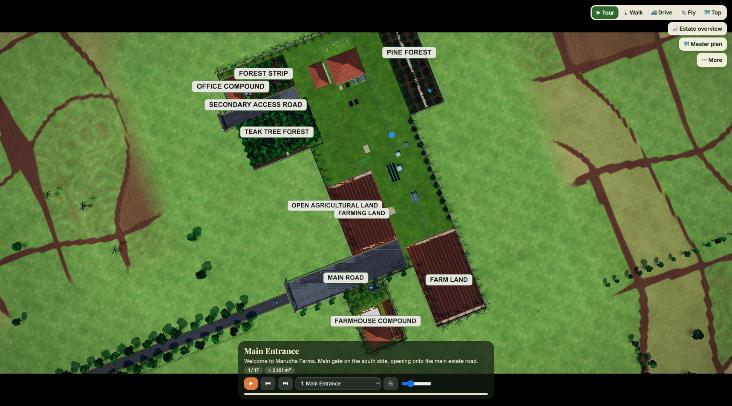 | 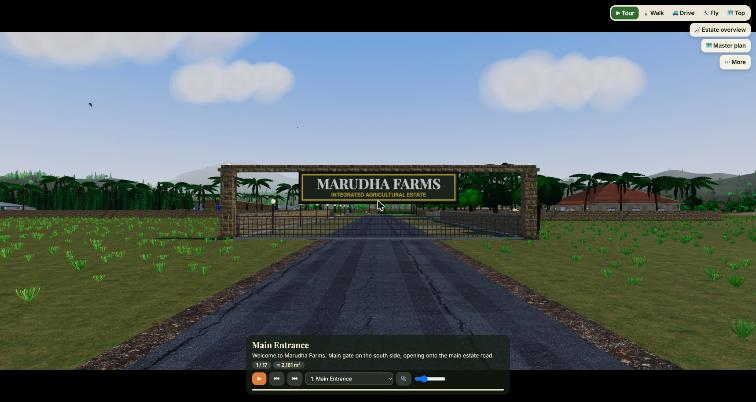 |
| 2. Main Road | 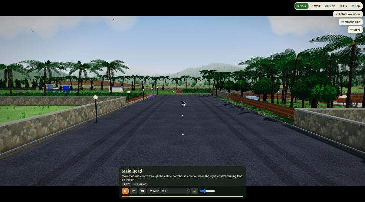 | 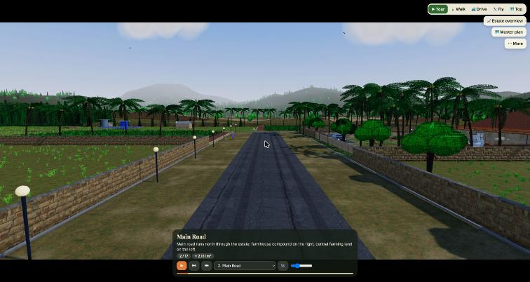 |
| 3. Car Parking | 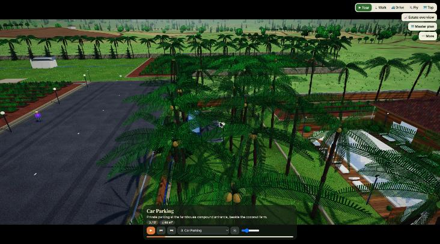 | 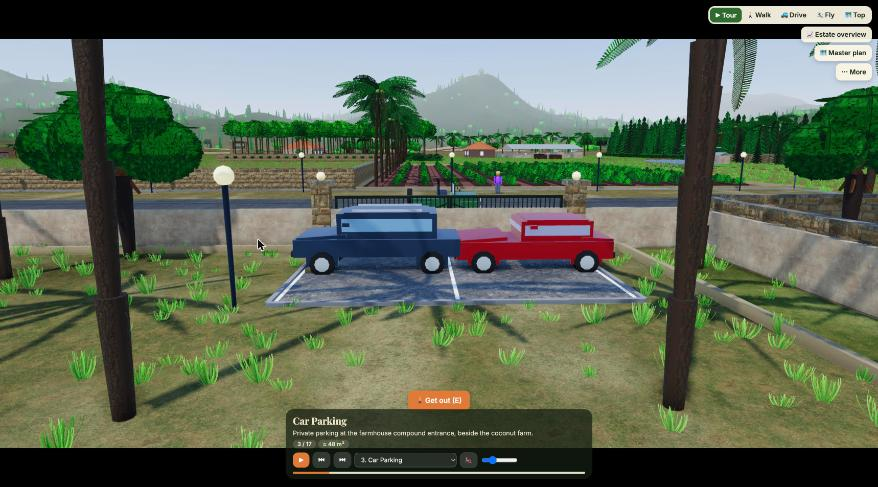 |
| 4. Swimming Pool | 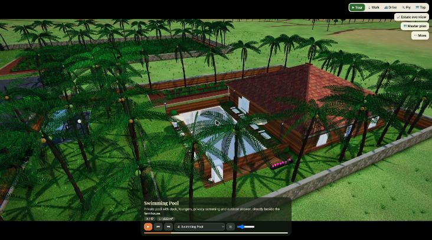 | 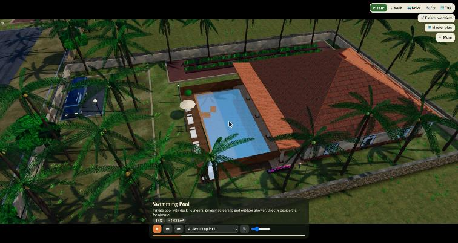 |
| 5. Farmhouse | 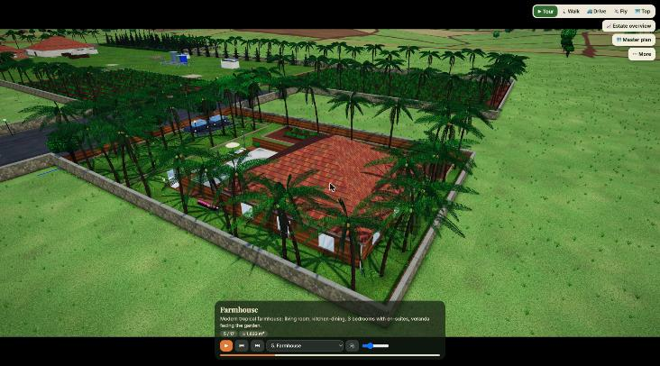 | 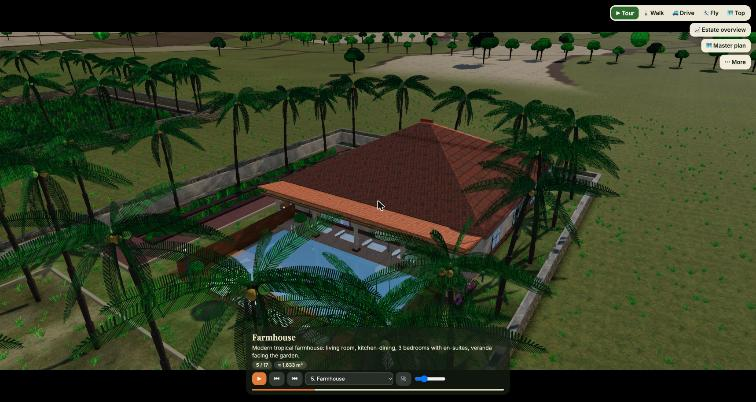 |
| 6. Coconut Farm | 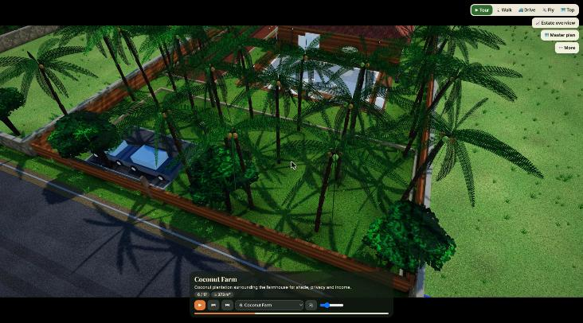 | 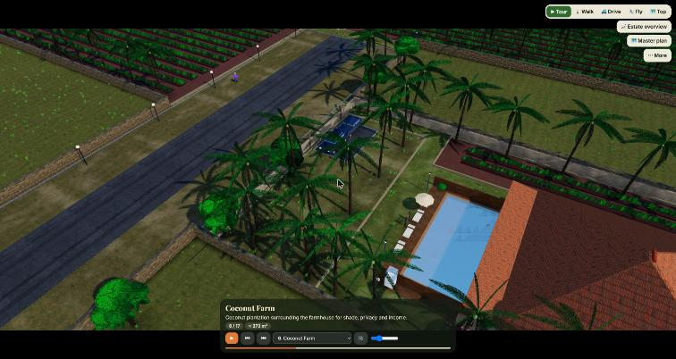 |
| 7. Farmland (North-East) | 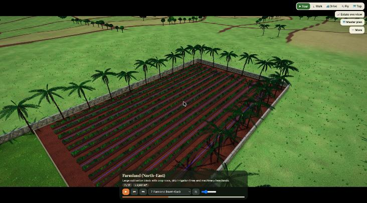 | 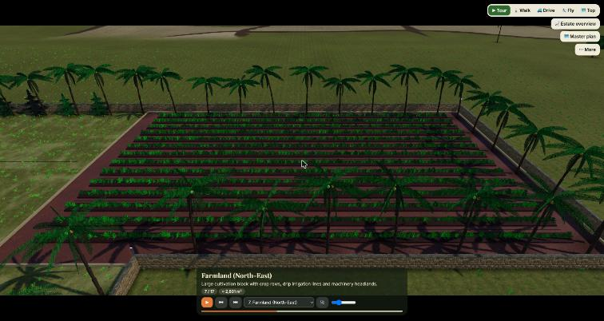 |
| 8. Central Farming Land | 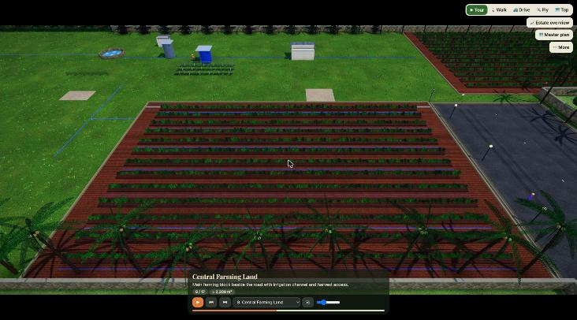 | 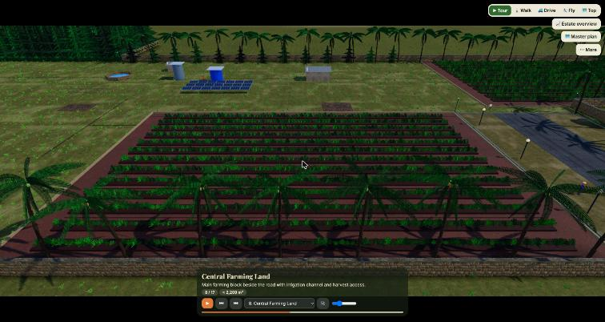 |
| 9. Solar & Machinery (proposed) | 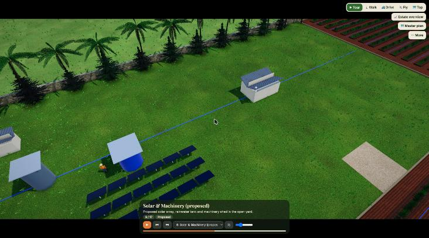 | 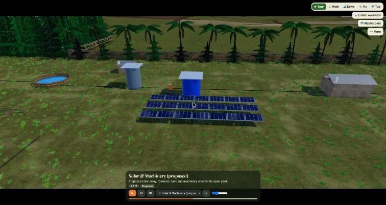 |
| 10. Central Well | 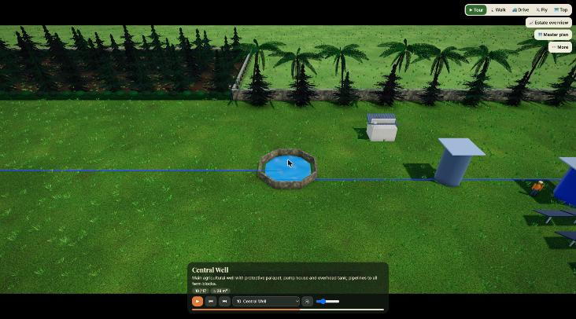 | 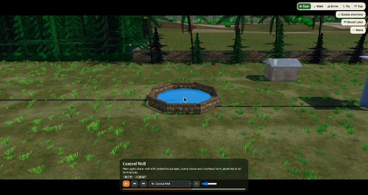 |
| 11. Goat Farm Shed | 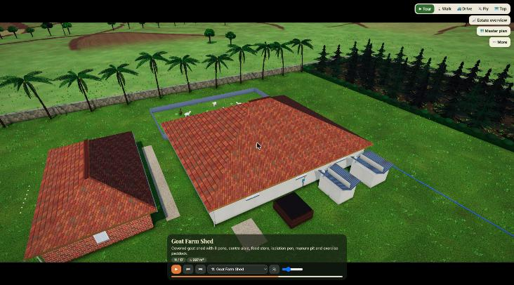 | 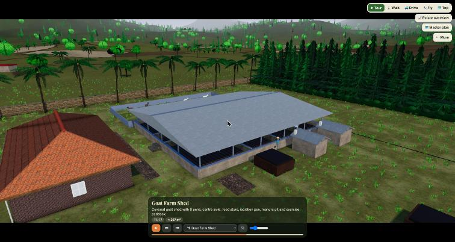 |
| 12. Labour Quarters | 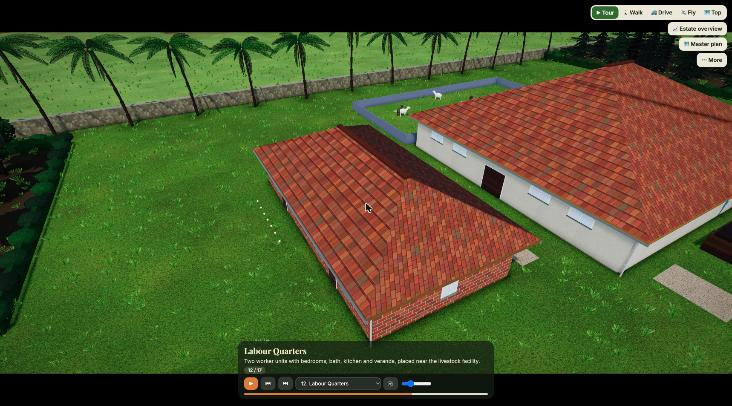 | 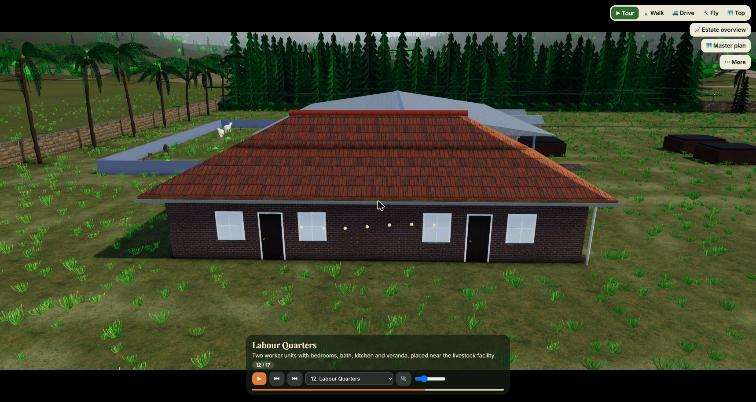 |
| 13. Secondary Entrance | 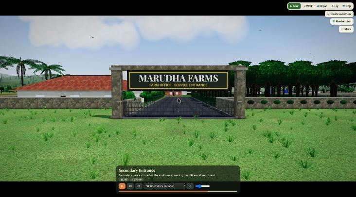 | 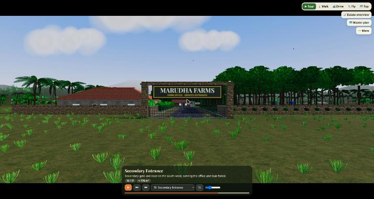 |
| 14. Farm Office | 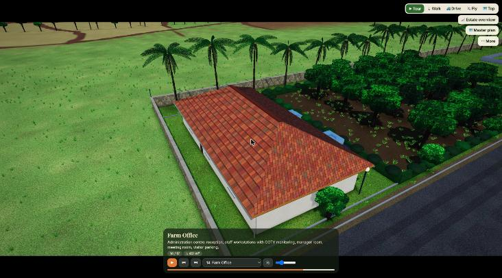 | 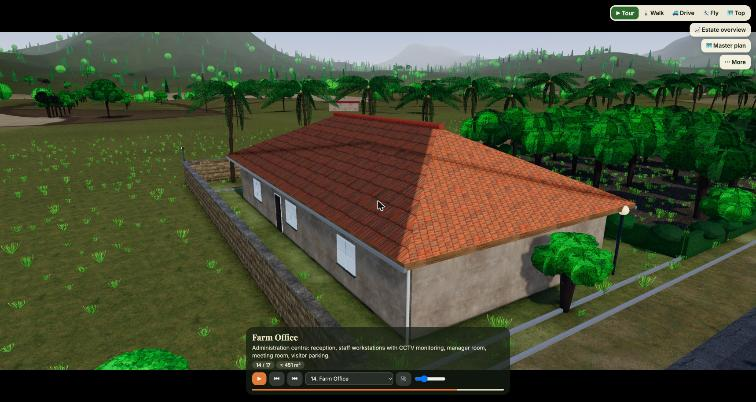 |
| 15. Teak Tree Forest | 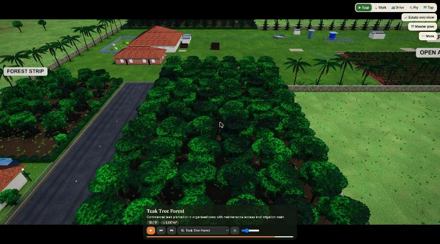 | 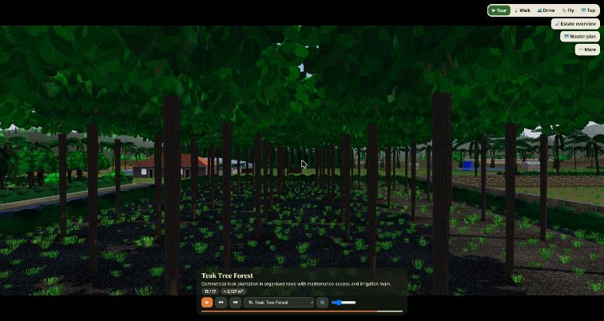 |
| 16. Pine Tree Forest | 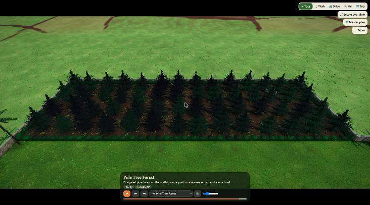 | 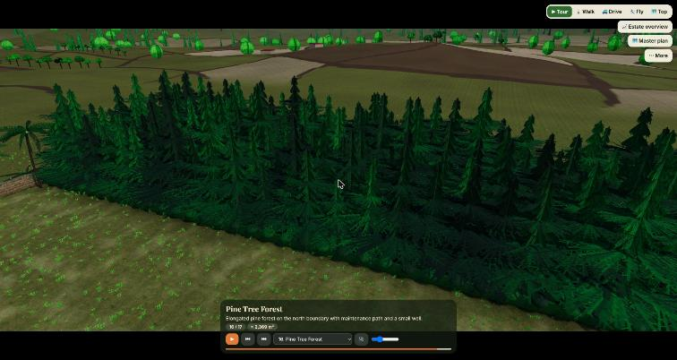 |
| 17. Marudha Farms (overview) | 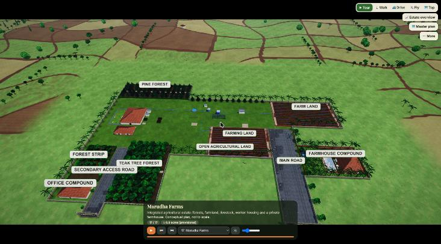 | 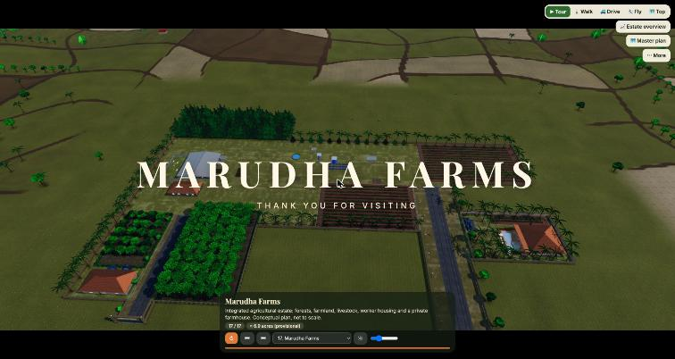 |

## Blocked / not done (honest list)

- **Real GLTF assets (Phase 1)** — BLOCKED from this environment: Poly Haven tree models are 46 MB–1 GB each (photoscans), Quaternius packs are Google-Drive only, Kenney returns 403, Sketchfab needs a login. All models remain procedural; PBR textures are real (Poly Haven CC0, see CREDITS.md).
- KTX2/Draco — N/A (no GLB assets). Textures are WebP, 2.8 MB total.
- Cascaded shadow maps — not done; one 4 k shadow map that follows the camera focus and widens with camera height.
- Weather / rain — not done.
- Lighthouse — cannot run here (no local Chrome); UNVERIFIED.
- Walk-in farmhouse interior, animated workers, engine sound — not done.
